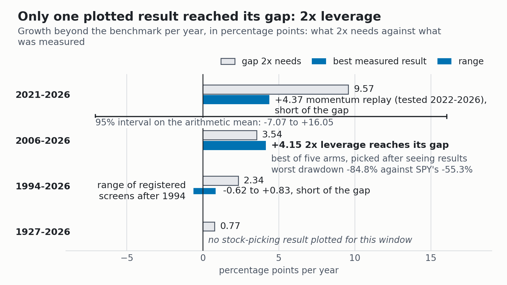
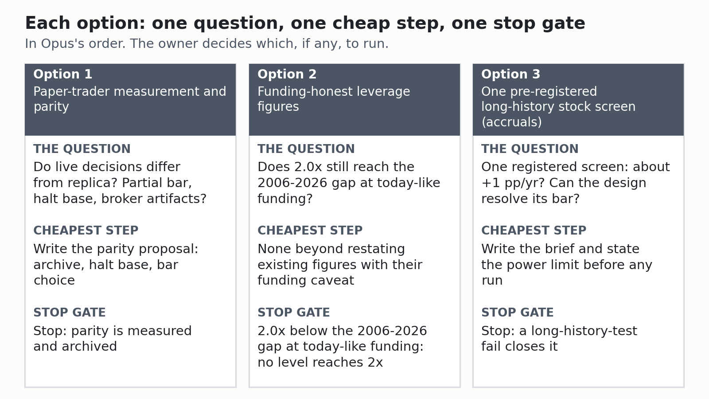

# Executive summary: why the research has not doubled SPY

**Date:** 2026-11-05. **One-page summary of the [plain-English findings](findings/2026-11-05-findings-plain-english.md) and the [direction review](reviews/2026-11-05-direction-reviews-consolidated.md). The originals stay as the record.** The owner accepted the synthesis on 2026-11-05, and the synthesis keeps its earlier status. Terms: [reference sheet](reference-sheet.md).

SPY is the fund that tracks the S&P 500. 2x means twice SPY's total return (price change plus reinvested dividends). pp/yr means percentage points a year.

> **The one-minute version.** The question: why has the research not come close to twice SPY's total return?
>
> - The built design shows no 2x-sized effect, and its test could have seen one, if PARA (a stock stored with another security's prices) proves immaterial.
> - Stock picking itself is undecided: none of 72 measured tests is reliable, none shows an edge, and none rules out 1 to 4 pp/yr.
> - Ceiling: only 2x leverage (exposure, not skill, at 1.64% funding, below today-like rates, worst fall -84.8%) and momentum before 1994 reached their window's gap.
> - After tax: a book that sells within a year needs about +2.42 pp/yr before tax (24%/15% brackets) just to tie SPY over 2021-2026.
> - Opus (unverified): measure the paper trader first, then no-write re-runs, then a small long-history screen budget with pre-set pass bars, best case about +1 pp/yr.
> - Argon is unverified as written: of its specifics, only numbers that trace to a check hold. Both call leverage your risk decision.
> - You accepted the synthesis on 2026-11-05 and decision 2 is done. Decisions 3 to 13 remain. Defaults until you answer: no re-runs, no live-trader change, the 2027-09-30 leverage review on existing figures.

## The five-minute version

The detail behind each point above.

### What we found

- **Built design.** The replica (live rules re-run on history) returned 14.19% a year against SPY's 14.83% over 2021-2026, or -0.64 pp/yr (t -0.69, which cannot be told from zero). The Verdict Trust check still counts it inconclusive against its own +1.0 pp/yr pass bar.
- **Power.** At whole-account level the replica could detect about 4.2 pp/yr (if PARA proves immaterial), so it answers the 2x question. At sleeve level, the stock part, it sees only above about 45 pp/yr, so stock picking stays open.
- **Stock picking.** Of 72 measured tests, 0 are reliable, 11 unreliable, 58 inconclusive (could not decide) and 3 stopped on their own terms. None shows an edge, and none rules out 1 to 4 pp/yr.
- **Crypto.** Every crypto portfolio with a recoverable record lost to holding bitcoin (BTC) over its three-year range, by 5 to 44 pp a year. Live crypto left no usable record (0 trades).
- **Ceiling.** Doubling needs 9.57 pp/yr over 2021-2026 and 3.54 over 2006-2026 against SPY, and 0.77 over 1927-2026 against the French market index.
- **Reaching it.** Only 2x leverage (+4.15 over 2006-2026, picked after seeing five arms, at that window's 1.64% average funding, worst fall -84.8%) and momentum before 1994 reached their window's gap. Leverage is exposure, not skill.
- **Paper.** Since 2026-06-24 the paper account trailed SPY in total (not per year) by 3.76 pp at run-time broker value and 4.57 on end-of-day equity.
- **Tax.** All 74 closed paper stock round trips were short-term. Such a book needs about +2.42 pp/yr before tax (24%/15% brackets) just to tie SPY after tax over 2021-2026, so a +1.0 pp/yr pre-tax edge becomes -1.08. This is a stylised model.

*Source: the Ceiling check. Percentage points a year beyond SPY or the French market index, so benchmarks differ by row. Leverage is exposure, not skill, and its bar holds only at that window's 1.64% funding. Momentum before 1994, which also reached its gap, is not plotted.*

### Why the target was missed

Ranked by judgement, no share measured:

1. The target is large next to every measured stock-picking effect.
2. The book is about 85% SPY and 9% stocks, so it cannot stray far. This is arithmetic.
3. Early "beat SPY" results came from leaks (information a test should not have had). They explain false optimism, not the shortfall.
4. The tests could not tell a small stock-picking edge from zero.
5. The paper shortfall is mostly idle cash and broker quirks (estimated split), and live runs no tested configuration.
6. The search stayed narrow: large-cap, long-only, mostly one signal family.

### What the two models recommend

**Opus** (one reviewer, not verified line by line):

- The built design cannot reach 2x, and no affordable free-data test can decide a 1 to 4 pp/yr edge.
- Order: paper-trader trust first, then cheap re-runs that write nothing to the price table, then a small pre-registered (pass bar written down first) long-history screen budget. Best case about +1 pp/yr (unverified judgement).
- Leverage is the owner's risk decision, dollar drawdown tolerance first. It names the synthesis's likeliest error: the leverage result rests on one window's 1.64% funding. Its own estimate at today-like funding, unmeasured, is about +1.65 pp/yr, below the 2006-2026 gap.

**Argon** (Gemini model, unverified as written):

- 43 of 105 citations are broken or unsupported. Numbers tracing to a check report hold.
- Survived: leverage as the owner's risk decision, the long-hold tax direction, and parking crypto, small caps, long-short and options (as judgement), and the gated walk-forward weak spot (already the synthesis's own position).
- Shown wrong: re-run item numbers, commit hashes, the trader-patch payoff and its dates. Dropped: the concentrated sleeve's payoff and odds.

**Agree:** the built design cannot reach 2x, and no-database re-runs come first. **Differ:** stock-picking prospects, and patching versus measuring the trader. The checked evidence sits closer to Opus.

**Three options**, in Opus's order, none approved:

- Option 1, paper-trader measurement and parity. Stop gate: "parity measured and archived".
- Option 2, funding-honest leverage figures for the 2027-09-30 review of A23 (70% SPY / 30% SSO, a fund targeting twice SPY's daily move). Stop gate: if the funding re-run puts 2x below the 2006-2026 gap at today-like funding, record that no tested exposure level reaches 2x at current rates.
- Option 3, one pre-registered long-history stock screen. Stop gate: a long-history-test fail closes it.

*Source: the consolidated review, which frames the options from Opus's recommendations. Option 2's cheapest step is derived by that review, not by Opus.*

### What you decide

Seven of the 13. Each open default holds until you answer.

| # | Decision | Default |
|---|---|---|
| 1 | Accept the synthesis. **Accepted 2026-11-05** | Open, nothing changes |
| 3 | Any Optional Re-run List item, including the seven that need no database | None run |
| 4 | A separate research copy of the price table, instead of the no-writes rule | The no-writes rule stays |
| 5 | Input-archive proposal for the frozen trader | No live change |
| 6 | Daily-loss halt base proposal (it fires at about 2.7%, not 3%) | No live change |
| 9 | Funding-honest leverage figures before the 2027-09-30 review, including A23 funding and tax records | Review on its date with existing figures |
| 10 | One benchmark everywhere | Not adopted |

### What this cannot tell you

- **Unmeasured and unrun.** No cause's share of the shortfall was measured. None of the 29 Optional Re-run List items was run, so their questions stay "unknown, re-run not run".
- **Price history.** On 2026-11-04 an agent ran a script only to read its help text, and it rewrote prices for 19 symbols (at most 27,579 rows). PARA's figures in two check reports can no longer be reproduced. The owner chose to leave the symbols as they are.
- **Who checked.** Argon is unverified, and nobody verified the Opus review line by line. The investigation itself was Claude only. Both models read one synthesis, so their agreement is not independent evidence.

Read next: the [findings](findings/2026-11-05-findings-plain-english.md) for the evidence, the [consolidated review](reviews/2026-11-05-direction-reviews-consolidated.md) for all 13 decisions, the [reference sheet](reference-sheet.md) for terms.
