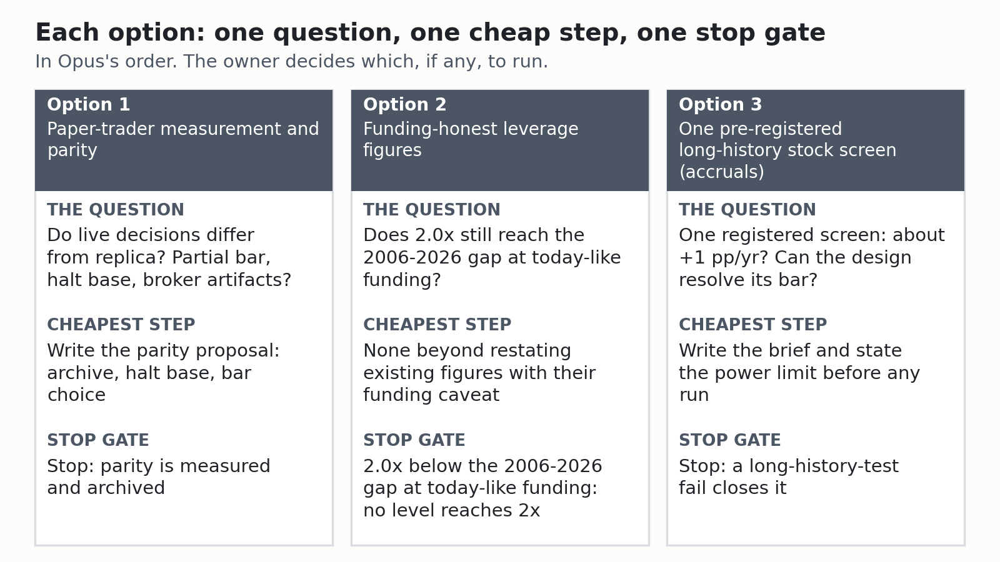

# Two frontier-model reviews of the root-cause investigation: both say the built design cannot reach 2x

**Date:** 2026-11-05. **Type:** editorial comparison of two direction reviews. It adds no computation and no new evidence. **Status:** reading edition. The originals stay as written and are the sources of record. The synthesis was accepted by the owner on 2026-11-05, and the originals keep the earlier status.

This page reports what Claude Opus and a Gemini model (Argon) recommend after reading the investigation, and which parts of the weaker review survived checking. It makes no recommendation of its own. Where this page derived something itself, the text says "derived".

Terms are defined at first use and in the reference sheet (`research/audits/root-cause-2026-11-04/reference-sheet.md`), which also maps each check and round name to its file. Citations are `file:line` with the date prefix dropped, and they point at the unchanged originals in this folder.

In this page 2x means twice SPY's total return over the same period, SPY is the fund that tracks the S&P 500 and is the benchmark, and pp/yr is percentage points a year.

> **The short version**
>
> - Opus (one review, unverified): the built design cannot reach 2x. Fix paper-trader trust first, run cheap no-write re-runs, then a small pre-registered long-history screen budget.
> - Opus also: that budget's best case is about +1 pp/yr (unverified judgement). Leverage is the owner's risk decision, with dollar drawdown tolerance first.
> - Argon (unverified as written): fix the test machinery and run safe re-runs, then trader parity, then a concentrated long-hold stock sleeve. Leverage is the owner's.
> - Verification: 43 of 105 citations broken or unsupported. Numbers tracing to a check report hold. Its dates, item numbers, hashes and payoff odds do not.
> - They agree the built design cannot reach 2x and no-database re-runs come first. Both read one synthesis, so agreement is not independent evidence.
> - They differ on stock picking (Argon's +1.5 to +4.0 pp/yr and its odds, both dropped by the verification) and on patching versus measuring the trader.
> - This page recommends nothing. The owner accepted the synthesis (decision 1) and decision 2 is done. Decisions 3 to 13 keep their defaults until answered.

## 1. What each reviewer recommends (Opus: one careful unverified review. Argon: checked, much of it wrong)

> **Takeaway:** Opus puts paper-trader trust first, and Argon's review, unverified as written, kept its direction but lost most of its dates, item numbers, hashes and payoff odds.

Both reviews assess the synthesis (`research/audits/root-cause-2026-11-04/findings/2026-11-04-root-cause-investigation.md`) and its challenge (`research/audits/root-cause-2026-11-04/findings/2026-11-04-root-cause-challenge.md`).

- The synthesis is the investigation's write-up.
- The challenge is the independent audit that argued the opposite case.

### Opus

- **Reviewer:** Claude Opus (`research/audits/root-cause-2026-11-04/reviews/2026-11-05-senior-quant-direction-review.md`), one reviewer, read-only (`senior-quant-direction-review.md:258-264`).
- **Reliability:** reliable as a single review. Its own estimates are labelled "(my estimate)" and are unmeasured (`senior-quant-direction-review.md:17-18`, `senior-quant-direction-review.md:259-261`, `senior-quant-direction-review.md:70`).

**Opus agrees with the synthesis on the point that matters** (`senior-quant-direction-review.md:22-24`):

- The built design is about 85% SPY, so it cannot reach 2x.
- No stock-picking result after 1994 comes within reach of the gap.
- It calls the synthesis's "stock picking is undecided" technically right but practically weak, because no affordable free-data test can decide a 1 to 4 pp/yr edge (`senior-quant-direction-review.md:23-25`).

**Its ranked direction has three parts** (`senior-quant-direction-review.md:27-31`):

1. Make the paper trader a trustworthy instrument.
   - Propose a saved copy of each run's inputs (an input archive).
   - Fix the halt-base defect: the daily-loss halt fires at about 2.7% because its starting value includes a dividend the broker never paid.
   - Measure the partial bar (today's unfinished price bar, which live signals use).
2. Run the handful of cheap re-run items that settle the leverage and power questions and write nothing to the price table.
   - Re-run items are numbered optional re-runs the investigation listed but did not run.
   - Power is whether a test could detect an effect of the size that matters.
3. Treat further stock picking as a small, pre-registered, long-history screen budget whose realistic best case is about +1 pp/yr, not 2x.
   - Pre-registered means the pass bar is written down before any result is seen.

**Its fourth recommendation is about leverage:**

- Leverage is a risk decision for the owner, not a strategy. It makes no allocation recommendation (`senior-quant-direction-review.md:148-162`).
- The owner's drawdown tolerance in dollars comes first.
- It asks for the 2.0x funding re-run (`P2-04`) and the funding and tax records item (`P2-18`) before the scheduled 2027-09-30 review of A23 (the owner-adopted 70% SPY / 30% SSO allocation, where SSO is a fund that targets twice SPY's daily move), so that review sees funding-honest figures (`senior-quant-direction-review.md:160-161`).

**It names the synthesis's most likely error:**

- The leverage ceiling is read as more reachable than it is, because the one window that reaches the gap had 1.64% funding (`senior-quant-direction-review.md:25-27`, `senior-quant-direction-review.md:81-85`).
- At today-like funding its own estimate puts 2.0x at about +1.65 pp/yr against a gap of 3.55, unmeasured (`senior-quant-direction-review.md:61-70`).

**It puts four items first that the synthesis lacks** (`senior-quant-direction-review.md:175-183`):

- One benchmark everywhere.
- After-tax as the primary metric for short-holding designs.
- A fixed yearly research budget (Holm control, a correction for testing several ideas at once, across the registered hypotheses).
  - Reason: 72 tests at a t of 2 bar make a false win 81% likely.
- A separate research copy of the price table.

Three of the four return as owner decisions in section 5 (decisions 4, 8 and 10). The after-tax metric appears only in the tax row of section 7.

**Its closing straight talk** puts the target in plain numbers (`senior-quant-direction-review.md:242-254`):

- If SPY earns 10% a year for 20 years, doubling its total return needs about 13.4% a year, a gap of about 3.4 pp/yr (its estimate).
- Nothing in the project, and nothing free data can test, shows stock picking delivering that.
- The honest paths left: keep the paper trader a reliable, measured instrument, test one or two pre-registered long-history ideas a year, and treat any leverage choice as a risk decision with dollar drawdowns written down first.
- Beating SPY by a little is a realistic research goal. Doubling it through skill is not supported by any evidence.

### Argon (unverified)

- **Reviewer:** Gemini 4 Argon run through agy, the Antigravity agent harness (`argon-review-verification.md:3`). It did not read the Opus review (`argon-synthesis-review.md:165`). File: `research/audits/root-cause-2026-11-04/reviews/2026-11-05-argon-synthesis-review.md`.
- **Status:** **unverified as written**. 43 of its 105 citations are broken or unsupported (`argon-review-verification.md:10`) and several specifics are invented (`argon-review-verification.md:13`).
- **Its five directions** (`argon-synthesis-review.md:64-113`), each with the verification's disposition in bold:

1. Repair the evaluation machinery (an ungated fixed-rule replay and a tax engine) and run the safe re-run items. **Corrected.**
   - The no-database-first intent is right.
   - Its item numbers and its `write_db` guard are wrong.
   - Its "zero tests" premise for the tax engine is dropped (TaxLotBook has 40).
   - An ungated re-run is `P2-26`, which takes tens of hours and writes to the price table.
2. Paper-trader reliability, with a staged parity proposal (parity: live matches the test). **Corrected.**
   - The divergences are real.
   - The payoff figure is wrong, and the freeze and clock-reset dates are invented.
3. Re-power stock picking on free data with a concentrated, low-turnover, long-hold sleeve. **Corrected**, with its payoff and odds **Dropped**.
   - The free-data plan fails.
   - Only the long-hold tax direction survives.
4. Leverage framed strictly as the owner's risk decision. **Survives.**
5. Park small caps, long-short, crypto and options. Leave the intraday observer running. **Survives** as judgement.
   - Its observer facts are shown wrong (section 8).

### The verification

The verification (`research/audits/root-cause-2026-11-04/reviews/2026-11-05-argon-review-verification.md`) is by Claude Sonnet, which did not read the Opus review (`argon-review-verification.md:3`). It states which Argon items survive (`argon-review-verification.md:90-105`):

- **Survives:**
  - The weak spot in the gated walk-forward machinery (walk-forward optimization, WFO: pick settings on a past window, test on the next unseen one, repeat), though the synthesis already holds that position.
  - The finding that +4.37 pp/yr is the plain 12-1 momentum anchor (12-1 momentum: buy the stocks that rose most over the past year, skipping the latest month). The anchor is the fixed fallback setting a fold runs when its gates reject the tuned one.
  - The long-hold tax direction.
  - The leverage framing.
  - "Park" for crypto, small caps, long-short and options, as Argon's judgement.
- **Corrected:**
  - Sweep tax churn.
  - A bill-ETF or drift-band sweep (an untested option).
  - Partial-bar volume.
  - The zero-database-first batch (intent right, ids and guard wrong).
  - The parity patch.
  - The concentrated sleeve's data plan (which fails).
  - The 30, 90 and 180-day plan (built on invented dates).
- **Dropped:** the payoff odds for the concentrated sleeve and the claim that TaxLotBook has no tests.
- **Not verified:** anything else in the Argon file.

Every Argon statement below carries its disposition, beside it or in the Verification column of section 7. Where the verification corrects a statement, the corrected form is the one used.

The verification's rule: trust Argon's numbers that trace to a check report, and nothing that names a commit hash, a date, a re-run item id or a file its citation audit could not find (`argon-review-verification.md:117`).

## 2. Where they agree: five points, none of them new

> **Takeaway:** Opus and Argon agree on five points: the built design cannot reach 2x, more exposure (a risk decision for the owner) is the only measured route to a much larger raw return, parity and no-database re-runs come first, and crypto spot is not worth time.

- The built design cannot reach 2x, and no post-1994 stock-picking result comes close (`senior-quant-direction-review.md:22-24`).
  - Argon's matching claim, that the production replica (the live rules re-run on history) was powered against 2x, is verified (`argon-review-verification.md:64`).
- The only measured route to a much larger raw return is more market exposure. That is a risk decision for the owner, not a research finding (`senior-quant-direction-review.md:31-33`, `argon-review-verification.md:103`).
- Paper-trader parity comes before alpha claims, and the trader stays frozen.
  - Opus frames changes as proposals through the deploy checks (`senior-quant-direction-review.md:107-108`).
  - The verification records the trader as frozen and the clock-reset question as unresolved (`argon-review-verification.md:95`, `argon-review-verification.md:128`).
  - It treats the partial-bar measurement (`P2-14`) as measurement only (`argon-review-verification.md:124`).
- Re-run items that need no database come first.
  - Items that write to the price table stay deferred while the no-writes rule stands (the owner's answer of no to re-runs writing to the shared price cache) (`senior-quant-direction-review.md:113-123`, `argon-review-verification.md:121-122`).
- Crypto spot strategies are not worth time (`senior-quant-direction-review.md:214-215`, `argon-review-verification.md:104`).

Agreement between two readers of one document is a lower bar than it sounds. See Limits.

## 3. Where they differ: the checked evidence sits closer to Opus

> **Takeaway:** The checked evidence sits closer to Opus on stock-picking prospects and on the trader, and the gated walk-forward machinery is a real limit but not a demonstrated cause.

**Stock-picking prospects.** Argon expects +1.5 to +4.0 pp/yr from a concentrated, low-turnover sleeve. The verification drops both the payoff and its odds.

- With Argon's own MDE (minimum detectable effect: the smallest true effect a test finds 80% of the time at its pass bar) of 9.1 pp/yr, the chance of a t of at least 3 is about 1% at +1.5 and 9% at +4.0 (`argon-review-verification.md:101`).
  - A t-statistic is an effect divided by its standard error, and 3 is the usual bar for "probably not luck".
- The data plan also fails (`argon-review-verification.md:100`).
  - Free stock-level fundamentals that use only what was known on each date (point in time, PIT) start in 2009.
  - The membership file starts in 1996.
- The momentum Argon leans on is +0.08 pp/yr after 1994 for big stocks (`argon-review-verification.md:100`).
- The verified evidence is consistent with Opus. The "about +1 pp/yr, not 2x" figure itself is Opus's unverified judgement (`senior-quant-direction-review.md:137-140`).

**How much the gated WFO matters.** Argon calls it the synthesis's biggest blind spot (`argon-synthesis-review.md:50-53`).

- The verification confirms 50 gated rows and 48 without an ungated arm (`argon-review-verification.md:48`).
- The 87.5% halt rate comes from a synthetic model with assumed inputs that "says nothing about any real strategy" (`argon-review-verification.md:47`).
  - The halt rate is how often the walk-forward circuit breaker stood a test down at least once, even for a strategy with a true Sharpe of 1.0.
- In the two checkable cases, removing the gate changed no verdict (`argon-review-verification.md:48`).
- Opus sees a smaller risk (`senior-quant-direction-review.md:85-89`).
  - The rules of the Verdict Trust check (the check that graded every past verdict by how far it can be trusted) arrived in one commit, and the reproduction checked application, not soundness.
  - Other rules could create a few reliable NOs but not a GO.
- Settled as a real limit that the synthesis already states, not a demonstrated cause.
  - Whether the gates hid or manufactured any result stays unknown (`root-cause-challenge.md:266-267`).
- Re-running without gates (`P2-26`) takes tens of hours and writes to the price table (`argon-review-verification.md:79`).

**Paper-trader change versus measurement.** Argon proposes a patch with an expected payoff.

- The payoff figure is wrong: it counts cumulative 4.4-month broker artifacts.
- The MNST split gap (MNST is Monster Beverage) is a paper-broker quirk that no trader patch recovers.
- Its dates are invented (`argon-review-verification.md:99`).
- Settled toward Opus: measure, document and propose, with payoff "none in raw return" (`senior-quant-direction-review.md:106`).

The remaining topics (partial-bar volume, tax, momentum, intraday) are in the side-by-side tables in section 7.

## 4. Three options, ranked in Opus's order

> **Takeaway:** No option's cheapest step runs a re-run: each is a document, a restatement of existing figures or a brief, and every measurement waits for the owner's allowance.

*Source: this section, shortened. Options are in Opus's order. Option 2's cheapest step is derived by this page, not by Opus. The owner decides which, if any, to run.*

The picture is a summary. The full text of each option follows.

**Standing rules:**

- No Optional Re-run List item runs unless the owner revisits that decision.
- No writes to the price table.
- The paper trader stays frozen.
- Free data only.
- Taxable account only.
- A NO-GO from any option is a result, not a reason to stop the work.

The order follows Opus's ranked direction (`senior-quant-direction-review.md:28-31`). Option 1 is Opus's first recommendation. Option 2 carries the purpose of Opus's second recommendation (the leverage item `P2-04`) and its fourth, a risk decision and not a strategy (`senior-quant-direction-review.md:148`). Option 3 is Opus's third.

### Option 1: paper-trader measurement and parity

- **Question:** do live decisions and values differ from the replica because of the partial bar (today's unfinished price bar, which live signals use at 12:45 PT), the dividend-inflated halt base or broker artifacts (`senior-quant-direction-review.md:94-98`)?
- **Cheapest step:** write the parity proposal covering the archive, the halt base and the bar choice (`senior-quant-direction-review.md:195`).
  - Recording MNST and AVB (AvalonBay) as paper-broker artifacts from committed reports alone is derived by this page.
  - Opus ties that step to the attribution read (`P2-05`, `senior-quant-direction-review.md:103-104`).
- **Prerequisites:**
  - To measure, the owner allows the partial-bar measurement (`P2-14`) and the attribution read (`P2-05`).
  - Both are read-only, about 1 hour for the first and 15 minutes for the second (`senior-quant-direction-review.md:99-104`).
  - Any live change goes through the deploy checks.
- **Falsifier (derived by this page, not from Opus):** the partial-bar measurement finding that partial-bar and final-bar decisions agree on nearly all of the 30 sessions would make the bar choice immaterial.
  - It would not falsify the halt-base or archive items, which stand on other evidence.
  - Opus's partial-bar checkpoint says only that a difference on more than a handful of sessions means the proposal must pick one bar for both live and replica (`senior-quant-direction-review.md:192-194`).
  - Opus's own change trigger runs the other way: a large partial-bar divergence moves parity ahead of everything (`senior-quant-direction-review.md:236`).
- **Stop gate:** "parity measured and archived" (`senior-quant-direction-review.md:108-109`).

### Option 2: funding-honest leverage figures for the 2027-09-30 A23 review

SSO is a ProShares fund that targets twice SPY's daily move. Funding is what borrowed exposure costs, here T-bill rates.

- **Question:** does 2.0x still reach the 2006-2026 gap at today-like funding (`senior-quant-direction-review.md:118-119`)?
- **Cheapest step (derived by this page):** none beyond restating existing figures with their funding caveat. The Opus estimate of about +1.65 pp/yr stays labelled unmeasured and not verified (`senior-quant-direction-review.md:67-70`).
- **Prerequisites:**
  - The owner allows the 2.0x funding re-run (`P2-04`: minutes, frozen inputs, no database) (`senior-quant-direction-review.md:114`).
  - Opus asks first for the owner's drawdown tolerance in dollars (`senior-quant-direction-review.md:161-162`, `senior-quant-direction-review.md:252-253`).
  - **The caveat is ruin, not return:** drawdowns of 66% to 85% in-window and over 90% in a 1929-style decline, where a forced sale at the bottom is the ruin path (`senior-quant-direction-review.md:156-157`).
  - The century study's 15% arm avoids the ruin flag at a 0.54 pp/yr after-tax cost, and 1.3x earns about +0.5 pp/yr at today-like funding (`senior-quant-direction-review.md:149-156`).
  - The 2.0x arm fell 84.8% (`senior-quant-direction-review.md:62`), and the century study's 30% arm fell 91.4% (`senior-quant-direction-review.md:84-85`).
  - Allocation stays the owner's call (`senior-quant-direction-review.md:160-161`).
- **Falsifier:** the 2.0x funding re-run shows 2.0x clearing the gap at +2.5 points of funding. Even then "it does not make it safer" (`senior-quant-direction-review.md:231-232`).
- **Stop gate:** the leverage-reach checkpoint (`senior-quant-direction-review.md:191-193`).
  - If the 2.0x funding re-run puts 2.0x below the 2006-2026 gap at today-like funding, record that no tested exposure level reaches 2x at current rates.

### Option 3: one pre-registered long-history stock screen (accruals)

The accruals screen tests a return pattern linked to how much of a firm's earnings are accounting accruals rather than cash. Pre-registered means the pass bar is written down before any result is seen.

- **Question:** can a single registered screen show about +1 pp/yr, and can the design resolve its bar at all (`senior-quant-direction-review.md:119`, `senior-quant-direction-review.md:137-140`)?
- **Cheapest step:** write the brief and state the power limit before any run (`senior-quant-direction-review.md:139-140`).
- **Prerequisites:**
  - A storage location for free downloads (`senior-quant-direction-review.md:224`).
  - The long-history test (the first stage of the owner-approved forward-paper standard, `research/programme/evidence-standard/2026-10-23-forward-paper-standard.md`) runs on French portfolio proxies, since free stock-level fundamentals start in 2009 (`argon-review-verification.md:125`).
  - French portfolio proxies are free survivorship-free American portfolio returns back to 1926, published by Professor Kenneth French.
  - The French-screen MDE item (`P2-02`) needs the owner's allowance.
- **Falsifier:** the French-screen MDE item shows an MDE at or below +1.0 pp/yr, which would make the long-history test more decisive than Opus expects (`senior-quant-direction-review.md:233-234`).
- **Stop gate:** a long-history-test fail closes it.
  - A kill-only replay (one run on 2021-2026, where a pass proves nothing) that finds an after-tax result more than 1.0 pp/yr below SPY's is the kill (`senior-quant-direction-review.md:200-201`, `senior-quant-direction-review.md:144-146`).
  - Opus adds that the pass bar of a t of 3 works in practice as an effect-size bar of roughly 2.5 to 4.4 pp/yr: a pass would imply a large effect, and a fail says nothing about effects below that (`senior-quant-direction-review.md:133-136`).

### Opus's own timeline

Opus's schedule for the three options (`senior-quant-direction-review.md:185-209`):

- **Days 0 to 30:** the owner decides on the synthesis, the seven no-database items run and the parity proposal is written.
- **Days 31 to 90:**
  - If approved, deploy the parity changes through the deploy checks and start a clean observation window.
  - Resolve the accruals feasibility items, register one brief and run the long-history test.
  - Run the concentrated big-cap momentum item if storage is approved.
- **Days 91 to 180:**
  - Review the first 90 days of archived paper decisions for parity only, not performance.
  - Prepare the funding-honest leverage table.
  - Run the kill-only replay only if the long-history test passed.
- Otherwise keep the budget unspent rather than open a new family by default.

### Left out of the options

- Opus's "not worth time" list, apart from crypto spot, which sits in section 2 (`senior-quant-direction-review.md:211-215`).
- The concentration checkpoint: for the concentrated big-cap momentum item (`P2-06`), a result below +2 pp/yr after 1994 means concentration needs no further work (`senior-quant-direction-review.md:202-203`).
- The change triggers:
  - That item above +2 pp/yr after 1994 (`senior-quant-direction-review.md:235`).
  - A full year of the intraday observer showing a large, cost-surviving effect (`senior-quant-direction-review.md:237`).
  - A free, survivorship-free small-cap universe becoming available (`senior-quant-direction-review.md:238`).
- Opus's concentration, small-cap and long-short notes (`senior-quant-direction-review.md:167-172`).
- The note that most of the 51 power failures mean power could not be computed (`senior-quant-direction-review.md:49-53`).
- The note that a 10 pp/yr sleeve edge takes 23 to 40 years to detect on paper (`senior-quant-direction-review.md:109-111`).

## 5. Owner decisions: 13 items, one list, each with a default

> **Takeaway:** Decision 1 is accepted and decision 2 is done. Decisions 3 to 13 carry a default that holds until the owner answers, and under those defaults no re-run item runs.

| # | Decision | Default | What it unlocks |
|---|---|---|---|
| 1 | Accept the synthesis (`senior-quant-direction-review.md:219`, `root-cause-investigation.md:736`). **Status: Accepted 2026-11-05** | Open, nothing changes | Decision 2 |
| 2 | Changelog entry and research-snapshot update (`root-cause-investigation.md:733`, `root-cause-investigation.md:739-740`). **Status: Done 2026-11-05** | Wait for decision 1 | Updated roster |
| 3 | Any Optional Re-run List item, including the seven that need no database (`senior-quant-direction-review.md:220`, `root-cause-investigation.md:743`) | None run (`root-cause-investigation.md:729`) | Options 1 to 3 beyond paperwork |
| 4 | A separate research copy of the price table, instead of the no-writes rule (`senior-quant-direction-review.md:221`) | The no-writes rule stays (`root-cause-investigation.md:730`) | The deferred price-table writers (`senior-quant-direction-review.md:120-122`) |
| 5 | Input-archive proposal for the frozen trader (`senior-quant-direction-review.md:222`) | No live change | A per-run input archive (`senior-quant-direction-review.md:101`) |
| 6 | Daily-loss halt base proposal (`senior-quant-direction-review.md:223`) | No live change | A halt computed from the broker value (`senior-quant-direction-review.md:102-103`) |
| 7 | Storage for new free downloads (`senior-quant-direction-review.md:224`) | None | Concentrated big-cap momentum item (`P2-06`), accruals |
| 8 | A yearly research budget (`senior-quant-direction-review.md:225`) | None set | Holm control (a correction for testing several ideas at once) across registered tests (`senior-quant-direction-review.md:180-181`) |
| 9 | Funding-honest leverage figures before the 2027-09-30 review, including A23 funding and tax records (`P2-18`) (`senior-quant-direction-review.md:226-227`, `root-cause-investigation.md:741-742`) | Review on its date with existing figures | Option 2 |
| 10 | One benchmark everywhere: SPY total return (price change plus reinvested dividends) against Alpaca's end-of-day equity, plus an exposure-matched SPY/cash book. Opus puts this first (`senior-quant-direction-review.md:175-178`) | Not adopted | The 5% cash reserve (about 0.9 pp/yr) is not read as stock-picking loss |
| 11 | Compute realized gain or loss per SPY sweep sale, read-only (`argon-review-verification.md:123`) | Not done | A real answer on sweep tax churn |
| 12 | Whether closed momentum and factor NO-GOs may be reopened for a sleeve (`argon-review-verification.md:125`) | Stay closed | A wider Option 3 |
| 13 | Deferred minor review notes in the ledger (`root-cause-investigation.md:744`) | Stay deferred | Nothing material |

## 6. Corrections: nine to Argon's claims, three to Opus's

> **Takeaway:** The verification corrects nine Argon claims, and the synthesis's recorded decisions and Opus's own bottom line correct three Opus statements.

From the verification, about Argon:

- The replica's primary result is 14.19% against SPY's 14.83%, with a holdout t of 0.69, not 14.41% against 15.05% and t 0.89 (`argon-review-verification.md:51`).
- The fix for the deflated Sharpe ratio (DSR) bug is commit `09f9f401`. The two hashes Argon gives do not exist (`argon-review-verification.md:49`).
- The 2026-11-04 incident rewrote at most 27,579 rows for 19 symbols through the cached loader. The "166,431 rows" and `write_db` story is invented (`argon-review-verification.md:53`).
- TaxLotBook (the project's tax-lot library) has 40 tests, not zero (`argon-review-verification.md:55`). A hand-calculable trace check is a fair new item, not a re-run id (`argon-review-verification.md:98`).
- No Optional Re-run List item was "halted". None was approved or run (`argon-review-verification.md:84`).
- The replica sorts candidates alphabetically, not by 20-day return (`argon-review-verification.md:63`).
- "+2.3 pp/yr over 20 to 30 years" doubles wealth only over 32 years. Twenty years needs 3.55 (`argon-review-verification.md:39`).
- "Near-zero interest rates" is wrong for the leverage window. Its funding averaged 1.64% (`argon-review-verification.md:39`).
- "50 negative WFO verdicts" includes GO rows (`argon-review-verification.md:48`).

From the synthesis, about Opus:

- Opus's decision "accept and merge the synthesis" (`senior-quant-direction-review.md:219`) is overtaken.
  - The synthesis records a note "added 2026-11-05 after the merge" (`root-cause-investigation.md:725-726`), although its open list still says not merged (`root-cause-investigation.md:737`).
  - The first version of the synthesis is on main as `e4362512` (`root-cause-investigation.md:808`).
  - Acceptance was open when the synthesis was written (`root-cause-investigation.md:736`). It was accepted by the owner on 2026-11-05, and the synthesis keeps the earlier status.
- Opus's lists of items to run (`senior-quant-direction-review.md:190`) sit against the recorded decisions: no Optional Re-run List item is run and the no-writes rule is in force (`root-cause-investigation.md:729-730`). They are options for the owner, not approved work.
- Opus's "near-zero funding costs" (`senior-quant-direction-review.md:82-83`) has the same flaw. Its own bottom line gives 1.64% (`senior-quant-direction-review.md:26`).

## 7. Side by side: what each says, and what the verification did to Argon

> **Takeaway:** The reviewers agree on the 2x verdict, re-run order, leverage, crypto and leaving the intraday observer running. They differ on the trader, stock-picking power, the gated machinery's weight and partial-bar volume. Only Argon raises the momentum replay and sweep tax churn.

Each row gives Opus's position, Argon's position (unverified), the verification's disposition of Argon's position and whether the reviewers agree. Dispositions are **Survives**, **Corrected**, **Dropped** or **Not verified**.

### Topics 1 to 6: the 2x verdict, the trader, re-runs, power, momentum and the gates

| Topic | Opus | Argon (unverified) | Verification | Status |
|---|---|---|---|---|
| 2x with the built design (about 85% SPY) | Negative, high confidence. The replica could detect 4.24 pp/yr against gaps of 9.57 and 6.14 (`senior-quant-direction-review.md:37-45`) | Same: the replica was well powered against 2x (`argon-synthesis-review.md:32`) | **Survives.** True, but already in the Test Power check and the synthesis (`argon-review-verification.md:64`) | ✅ Agree |
| Paper-trader reliability | First priority: measure the partial bar, propose an input archive and a broker-based halt base, document MNST and AVB as broker artifacts, leave the cap, sizing and parameters alone (`senior-quant-direction-review.md:93-111`) | A parity and tax-hygiene patch, a dated freeze and a clock reset (`argon-synthesis-review.md:76-86`) | **Corrected.** Divergences are real. "Recovers 0.85-1.00 pp/yr" is wrong. Freeze and reset dates invented (`argon-review-verification.md:99`, `argon-review-verification.md:54`) | ⚠️ Differ: patch versus measure first |
| The 29 unrun re-run items | No-database items first, defer price-table writers (`senior-quant-direction-review.md:113-123`) | Same intent, but wrong item numbers and a non-existent `write_db` guard (`argon-synthesis-review.md:67-68`) | **Corrected.** Intent matches the no-writes rule. Ids mislabelled. No guard exists (`argon-review-verification.md:97`, `argon-review-verification.md:74-84`) | ✅ Agree on intent. Argon ids dropped |
| Stock-picking power | "Undecided" at 1 to 4 pp/yr, not at 2x. Detecting +1.0 pp/yr at TE 6.5% needs about 620 years (Opus estimate, not verified) (`senior-quant-direction-review.md:54-59`, `senior-quant-direction-review.md:126-136`) | Re-power with a 1994-2026 concentrated sleeve. +1.5 to +4.0 pp/yr, 15-25% chance of t at least 3 (`argon-synthesis-review.md:88-99`) | Square-root-of-time arithmetic **Survives**. Payoff odds **Dropped** (about 1% to 9%). The data plan is **Corrected**, and it fails (`argon-review-verification.md:57`, `argon-review-verification.md:100-101`) | ⚠️ Differ |
| Momentum replay (+4.37 pp/yr) | Not addressed | Gates rejected 17 of 17 folds, so +4.37 pp/yr is the plain 12-1 momentum anchor (`argon-synthesis-review.md:51`) | **Survives.** The cited commit hashes are wrong (`argon-review-verification.md:49`, `argon-review-verification.md:93`) | Argon only |
| Gated-WFO machinery | The Verdict Trust check's rules came in one commit and the reproduction checked application, not soundness. Other rules could create a few reliable NOs, not a GO (`senior-quant-direction-review.md:85-89`) | The synthesis's "biggest blind spot" (`argon-synthesis-review.md:50-53`) | **Survives**, but it is already the synthesis's position. Keep the synthetic-model caveat (`argon-review-verification.md:92`) | ⚠️ Differ in weight |

- **Paper-trader reliability:** the real divergences are rows 1, 4, 8 and 14 of the Code Correctness check, which asks whether the code does what the spec says.
- **Stock-picking power:** TE is tracking error, how far a book strays from its benchmark.
- **Momentum replay:** the +4.37 pp/yr has t 0.76 and a 95% interval of -7.07 to +16.05 on the arithmetic mean excess, so it is not significant (`research/audits/root-cause-2026-11-04/lenses/2026-11-04-lens4-feasibility-and-ceiling.md:238`).
- **Test Power check:** the check of whether past tests could see an effect.

### Topics 7 to 11: leverage, tax, partial-bar volume, crypto and intraday

| Topic | Opus | Argon (unverified) | Verification | Status |
|---|---|---|---|---|
| Leverage | Exposure, not skill. 2.0x at today-like funding about +1.65 pp/yr (Opus estimate, not verified). Drawdowns of 66% to 85% in-window and over 90% in a 1929-style decline. The 2.0x arm fell 84.8%. No allocation advice (`senior-quant-direction-review.md:61-70`, `senior-quant-direction-review.md:148-162`) | Same framing. 2.0x "+1.5 to +2.5" (`argon-synthesis-review.md:106-108`) | **Survives.** The 1.3x figures are verified. The 2.0x figure is inference, "about +1.7, unmeasured" (`argon-review-verification.md:58-59`, `argon-review-verification.md:127`) | ✅ Agree |
| Tax | After-tax as the primary metric for short-holding designs (`senior-quant-direction-review.md:178-179`). Annual rebalancing realizes fewer short-term gains (inference, `senior-quant-direction-review.md:140-143`) | 52 SPY sweep trades churn a taxable account. Holds over 366 days cut the hurdle (`argon-synthesis-review.md:48`, `argon-synthesis-review.md:92`) | Sweep churn **Corrected**: trade count verified, wash-sale harm unestablished, "1-2 pp/yr" unsourced. Holding-period direction **Survives**, saving about 1.9 to 4.3 pp/yr (`argon-review-verification.md:50`, `argon-review-verification.md:102`, `argon-review-verification.md:123`) | Argon only for the sweep. Agree in kind on holding period |
| Partial-bar volume | Measure it (`P2-14`) (`senior-quant-direction-review.md:99-100`) | Partial volume suppresses entries of vbb. Proposes a code change (`argon-synthesis-review.md:56`, `argon-synthesis-review.md:80`) | **Corrected.** Direction plausible, 24-28% of volume missing in two samples, effect unmeasured (`argon-review-verification.md:62`) | ⚠️ Differ. Argon's direction plausible, unmeasured |
| Crypto | Did not beat BTC (bitcoin) over three years (`senior-quant-direction-review.md:78-79`). Spot strategies "not worth time" (`senior-quant-direction-review.md:214-215`). Beyond spot and options, low (`senior-quant-direction-review.md:171-173`) | Park active crypto (`argon-synthesis-review.md:116`) | **Survives** as judgement. Figures verified (`argon-review-verification.md:60`) | ✅ Agree |
| Intraday | Let the observer finish, do not read early. Its rule holds SPY about 30 minutes a day, so even a positive result is small in raw-return terms (`senior-quant-direction-review.md:164-167`) | Leave it running. Dates, timer and trade count stated (`argon-synthesis-review.md:114`) | Action **Survives**. Facts shown wrong: the window is 2026-10-30 to 2027-11-03, there are four timers, and "0 completed trades" is unsourced (`argon-review-verification.md:61`) | ✅ Agree on action |

- **Leverage (the verified 1.3x figures):** with funding 2.5 points higher, the 1.3x arm's margin is +0.52 pp/yr before tax against SPY's true total return. On the A23 study's own basis it is +0.81 before tax and +0.80 after tax at the 24%/15% brackets (`research/audits/root-cause-2026-11-04/lenses/2026-11-04-lens4-feasibility-and-ceiling.md:247`, `research/audits/root-cause-2026-11-04/lenses/2026-11-04-lens4-feasibility-and-ceiling.md:290`).
- **Tax:** a wash sale is a loss disallowed because the same fund was rebought within 30 days.
- **Partial-bar volume:** vbb is the volume-confirmed Bollinger voter, one of five in the live ensemble.

A separate bill-ETF or drift-band sweep is an untested option for the unfrozen shadow design, not a verified fix (`argon-review-verification.md:95`).

### The two lists of re-run items differ

- Opus's seven no-database items are (`senior-quant-direction-review.md:114-116`):
  - `P2-01`, a regime split from committed output.
  - `P2-02`, the French-screen MDE.
  - `P2-04`, 2.0x at higher funding.
  - `P2-05`, the MNST and AVB attribution read.
  - `P2-07` and `P2-08`, the parity reads.
  - `P2-14`, the partial-bar measurement.
- The verification's restatement of Argon's list is `P2-02`, `P2-04`, `P2-06`, `P2-09`, `P2-10` and `P2-14` (`argon-review-verification.md:121`).
- Opus also defers `P2-27` as a price-table writer (`senior-quant-direction-review.md:120`), which the verification's writer list does not include (`argon-review-verification.md:81`, `argon-review-verification.md:122`).
- Decision 3 in section 5 uses Opus's list.

## 8. What to ignore in the Argon review

> **Takeaway:** Eleven Argon items are dropped or shown wrong by the verification, including its re-run item numbers, its invented dates and its payoff odds (`argon-review-verification.md:117`).

- Its re-run item numbers and "skip the remaining 17 items" (`argon-review-verification.md:74-82`).
- The `write_db=False` guard, `fetch_tiingo_ohlcv`, `refresh_universe_history` and the 166,431-row incident (`argon-review-verification.md:53`, `argon-review-verification.md:63`).
- The 2027-05-02 freeze and the 2026-11-15 clock reset. The record says unresolved (`argon-review-verification.md:54`, `argon-review-verification.md:128`).
- "TaxLotBook has zero tests" (`argon-review-verification.md:55`).
- The `NVDA` and `META` story and "1.12 collapsing to -0.17" (`argon-review-verification.md:52`).
- The EDGAR plan (EDGAR is the American Securities and Exchange Commission's public filings database), the ids `a05` and `a19`, and `sp500_pit_constituents.csv` (`argon-review-verification.md:63`).
- "+1.5 to +4.0 pp/yr" and "15-25% to clear t at least 3" (`argon-review-verification.md:101`).
- "Recovers 0.85-1.00 pp/yr" and "1-2 pp/yr" of wash-sale leakage (`argon-review-verification.md:99`, `argon-review-verification.md:50`).
- "0 completed trades" and a single observer timer (`argon-review-verification.md:61`).
- Argon's 30, 90 and 180-day plan, built on the invented dates and data plan (`argon-review-verification.md:105`).
- The 19 cited paths that do not exist (`argon-review-verification.md:20-33`).

## Limits

> **Takeaway:** Both reviews read the same synthesis, so their agreement is not independent evidence, and nobody verified the Opus review line by line.

- This page's own inference: both reviews assessed the same synthesis and challenge (`senior-quant-direction-review.md:5-8`, `argon-synthesis-review.md:12`), so their agreement is not independent evidence. Two readers of one document can share its blind spots.
- The Opus review is one reviewer with no second model family (`senior-quant-direction-review.md:258-259`), and nobody verified it line by line the way the verification checked Argon.
- Opus itself read only targeted sections of the check reports, and it did not re-verify owner decisions recorded only in the ledger copy (`senior-quant-direction-review.md:261-264`).
- This page adds no computation, and every Opus estimate it repeats is unmeasured.
- The verification's line numbers for the Argon file (the numbers it writes with an "L") predate the banner and the pointer line at the top of that file. Add 7 to get current line numbers.
